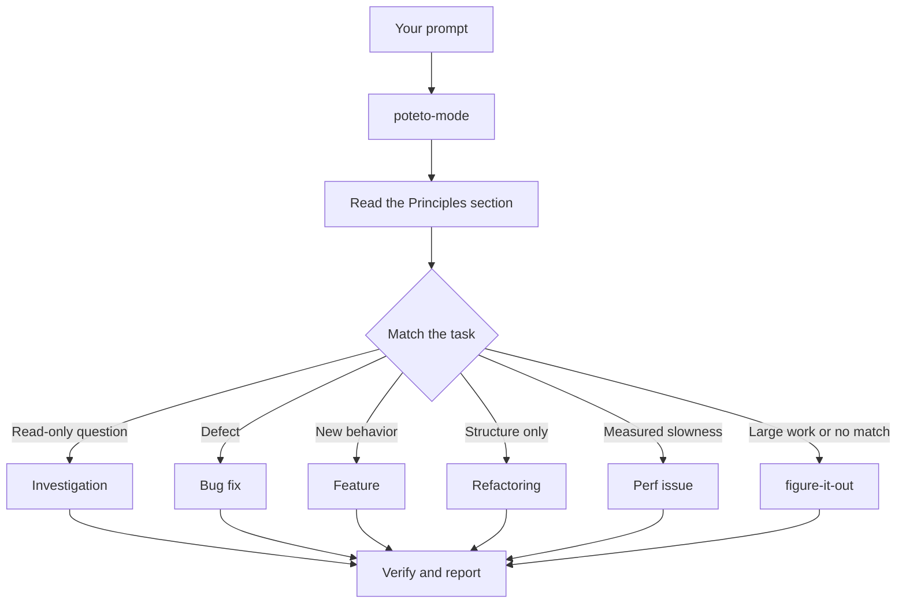

# บทที่ 2: สั่งงานผ่าน `/poteto-mode`

`/poteto-mode` คือประตูหน้าของระบบ คุณโยนเป้าหมายเข้าไป มันจะจับคู่กับ 1 ใน 22 playbooks (ชุดขั้นตอนปฏิบัติ) คัดลอกขั้นตอนของ playbook นั้นลงใน todo list และเรียกใช้ skill อื่นๆ ตามที่แต่ละขั้นต้องการ ในบทนี้คุณจะได้เรียนรู้ว่า prompt ที่ดีหน้าตาเป็นอย่างไร และจริงๆ แล้วคุณต้องพิมพ์น้อยแค่ไหน


## เกิดอะไรขึ้นกับ prompt ของคุณ



แผนภาพด้านบนแสดงเส้นทางที่พบบ่อย ยังมี playbook อื่นๆ สำหรับการไต่ระดับตัวเลขวัดผล (hillclimb), การวิเคราะห์อาการระหว่างรันและ profiling trace (runtime/trace forensics), การทำ prototype, การเทียบหน้าตา UI ให้ตรงกันระดับพิกเซล (visual parity), การเขียนและประเมินผล skill (authoring & eval), การรันอัตโนมัติ (autonomous run), การเปิด PR, การเฝ้า PR หรือ stack จนพร้อม merge (babysit), การนำ stack ที่ตรวจแล้วขึ้น merge (shipping), การรันคิว PR แบบ autopilot, การรับช่วงต่อจาก session เดิม (session pickup), การหยุดพักอย่างปลอดภัย (pause safely), แผนงานหลายเฟส (multi-phase plan), และการเคลียร์ worktree (worktree cleanup) ดูรายการทั้งหมดได้ใน [โฟลเดอร์ playbook](../../../skills/poteto-mode/playbooks/)

## บอกเป้าหมาย ไม่ต้องเขียนพิธีรีตอง

คุณไม่ต้องเขียน spec ยาวๆ แค่บอกว่ามีอะไรผิดปกติหรืออยากได้อะไร บวกกับข้อมูลที่คุณรู้อยู่แล้วเพื่อช่วยประหยัดเวลาให้ agent:

```text
/poteto-mode users get two notifications after a retry. repro first, then fix and verify.
```

นี่คือ prompt แบบ Bug fix คำว่า "repro first" คือเงื่อนไขบังคับจริง ไม่ใช่คำพูดสุภาพ และ playbook จะยึดตามนั้นอย่างเคร่งครัด ลองสังเกต todo list ที่จะถูกเติมด้วยขั้นตอนของ Bug fix ได้เลย

## ใน prompt ควรใส่อะไรบ้าง

prompt ที่มีประสิทธิภาพจะบรรจุองค์ประกอบไม่เกิน 5 อย่าง และแต่ละอย่างเขียนให้จบได้ในหนึ่งประโยค:

- **เป้าหมาย (The goal):** บอกว่าอะไรพัง หรือต้องการอะไร
- **เกณฑ์จบงาน (The done check):** ต้องตัดสินได้ว่าผ่านหรือไม่ผ่าน "ทำให้ดีขึ้น" หรือ "ลองทำสักชั่วโมง" ไม่ใช่เกณฑ์เช็ก
- **หลักฐานที่อยากเห็น (The proof you want to see):** ขอผลลัพธ์ของคำสั่งจริง วิดีโอตอนกดใช้งาน ค่าที่ถูกบันทึกลงระบบ หรือตัวเลขก่อน-หลัง
- **สิ่งที่คุณรู้อยู่แล้ว (What you already know):** อาการที่เจอ ขั้นตอนการ reproduce บรรทัด log หรือลิงก์ ช่วยลดเวลาค้นหาของ agent
- **ข้อจำกัดจริง (The real constraints):** เช่น "repro first", "don't change any code yet", "zero behavior change", และ "let me review before proceeding" แต่ละวลีเปลี่ยนพฤติกรรมของ agent โดยตรง

ตัวอย่าง prompt ที่ครบทั้ง 5 ข้อ:

```text
/poteto-mode the csv export drops its last row since yesterday's deploy. failing job id is 4812. repro first, then fix. done means the 60k-row fixture exports every row. show me the row counts before and after.
```

และนี่คือ 2 อย่างที่ **ควรตัดทิ้ง** จาก prompt:

- **วิธีการ (The how):** บอกผลลัพธ์ที่อยากได้ แล้วปล่อยพื้นที่ให้ agent หาทางที่ดีกว่าที่คุณคิดไว้ เรื่องเดียวกันนี้รวมถึงการไล่รายชื่อ skill ด้วย (ดูคำเตือนในหัวข้อกับดักด้านล่าง)
- **ทฤษฎีสาเหตุของคุณในตอนแรก:** การบอกเดาของคุณไปก่อนจะบีบให้ agent ไปค้นหาเฉพาะตรงจุดที่คุณชี้ ให้ agent สรุปปัญหาใหม่ด้วยคำพูดของตัวเองก่อน แล้วค่อยแชร์ข้อสันนิษฐานของคุณ

สำหรับรายงานที่สับสนยุ่งเหยิง เช่น thread ยาวๆ หรือบั๊กที่ยังคลุมเครือ ให้กำหนดการทวนความเข้าใจเป็นขั้นแรก:

```text
/poteto-mode read this thread. restate the underlying issue in your own words, in plain english. don't change any code yet.
```

ถ้า agent เข้าใจผิด มันจะโผล่ออกมาให้เห็นตั้งแต่ตอนทวนความเข้าใจ ก่อนที่โค้ดสักบรรทัดจะถูกเขียน แก้ไขตรงนั้นใช้แค่ข้อความเดียว แทนที่จะต้องไปตามแก้โค้ดที่ทำผิดทาง ถ้าแค่อยากให้ทวนความเข้าใจอย่างเดียวโดยไม่เปิด playbook ให้ใช้ [`/in-your-own-words`](../../../skills/in-your-own-words/SKILL.md) มันจะสรุปกลับมาว่าคิดว่าเป้าหมายของคุณคืออะไร และกำลังแก้ปัญหาอะไรอยู่

เมื่อไม่แน่ใจว่า prompt ที่ร่างไว้ยิงตรงเป้าหรือยัง ให้รัน [`/sharpen`](../../../skills/sharpen/SKILL.md) เพื่อขัดเกลา prompt ก่อนส่งจริง:

```text
/sharpen write a migration guide for the v2 config format.
```

agent จะบอกคุณว่าผู้เชี่ยวชาญระดับท็อปจะทำอะไรเพิ่มในสิ่งที่คุณไม่ได้ขอ วัตถุดิบที่ดิบที่สุดที่ควรตั้งต้น วิธีและเครื่องมือที่ควรใช้ และหลักฐานภายนอกที่จะพิสูจน์ว่าผลลัพธ์ถูกต้อง จากนั้นมันจะเขียน prompt ให้คุณใหม่ให้ลึกขึ้นแต่ไม่บวมขึ้น โดย prompt ใหม่จะสั่งให้ agent ทำ prototype เพื่อตัดสินทางเลือกที่พิสูจน์ได้ด้วยการทดลองและแนะนำตัวเลือกจากสิ่งที่สังเกตเห็น ส่วนการตัดสินใจด้าน product หรือความชอบส่วนตัวจะเหลือไว้ให้คุณ ตัว `/sharpen` จะยังไม่ลงมือทำงานจริง คุณแค่อ่านฉบับที่ปรับแล้วและส่งออกไป (เช่น นำไปต่อท้าย `/poteto-mode`)

## ตอบกลับสั้นๆ เมื่อบริบทพร้อมแล้ว

เมื่อในบทสนทนามีบริบทครบแล้ว prompt ถัดไปสามารถย่อให้สั้นมากๆ ได้ทั้งหมดนี้:

```text
/poteto-mode do it
```

```text
continue
```

```text
keep going until done
```

คำสั่งสั้นๆ ได้ผลเพราะตัว playbook เป็นคนถือโครงสร้างขั้นตอนไว้ และ Custom Mode คอยรักษา `/poteto-mode` ให้อยู่ใน context ทุกเทิร์น (ดูวิธีเปิดใช้งานใน [บทที่ 1](./01-setup.md#รันงานแรกของคุณ)) คำพูดของคุณถือเจตนา ส่วน skill ถือความรัดกุม

## สลับหัวข้องานด้วยคำว่า "new task"

แชทยาวๆ จะสะสมบริบทจากงานก่อนหน้า เมื่อเปลี่ยนเรื่อง ให้พูดออกมาตรงๆ:

```text
/poteto-mode new task. figure out why the cache entry survives logout. don't change any code yet.
```

"new task" บอกให้ `/poteto-mode` จับคู่ playbook ใหม่แทนที่จะเดินตาม playbook เดิมต่อ และ "don't change any code yet" จะล็อกงานนี้ให้อยู่ใน Investigation playbook หากขาดสองวลีนี้ โหมดที่กำลังรัน Feature ค้างอยู่มักตีความคำถามใหม่ของคุณว่าเป็นขั้นตอนถัดไปของฟีเจอร์เดิม

## แยกเครื่องให้ชัดเมื่องานวิ่งขนานกัน

ถ้าคุณรัน agent หลายตัวบน repository เดียวในเครื่องเดียวกัน พวกมันจะแย่ง working tree, แย่ง port, และเขียนทับ build output กันเอง การแยกที่สะอาดที่สุดคือ [cloud subagent](https://cursor.com/docs/subagents#cloud-subagents) แต่ละตัวได้ VM และ branch ของตัวเอง จึงลง dependency รันแอป และอัดวิดีโอผลลัพธ์ได้โดยไม่แตะเครื่องของคุณ พิมพ์ `/in-cloud` ก่อนงาน หรือสั่งให้แชทหลักส่งงานไปให้ cloud subagent

หากงานต้องอยู่บนเครื่อง (local) ให้ขอแยก worktree ตั้งแต่แรก:

```text
/poteto-mode new task. branch off <base> in a fresh worktree, then port the parser change there.
```

*(บน Antigravity ให้ subagent ใช้ `Workspace: "share"` หรือ `"branch"` เพื่อแยก working copy)*

การให้งานแต่ละชิ้นอยู่ใน branch และ worktree ของตัวเองทำให้ไม่มี agent ตัวไหนเหยียบไฟล์ของอีกตัว Worktree ใช้พื้นที่ดิสก์และทรัพยากรเครื่อง ดังนั้นโน้ตบุ๊กหนึ่งเครื่องจึงรันพร้อมกันได้แค่ไม่กี่ตัว ปกติ [Opening a PR playbook](../../../skills/poteto-mode/playbooks/opening-a-pr.md) จะทำงานจาก worktree ให้อยู่แล้วสำหรับงานแก้โค้ด ดังนั้นส่วนใหญ่คุณต้องระบุเรื่องนี้เฉพาะตอนที่ฐาน branch หรือตำแหน่งโฟลเดอร์มีความสำคัญเป็นพิเศษ

เมื่อ worktree สะสมจนดิสก์ใกล้เต็ม ให้สั่ง:

```text
/poteto-mode what's eating my disk? prune the worktrees that are safe to prune.
```

[Worktree cleanup playbook](../../../skills/poteto-mode/playbooks/worktree-cleanup.md) จะจำแนก worktree ทุกตัวตามสถานะการ merge, การแก้ไฟล์ที่ยังไม่ commit, และดูว่ามีแชทไหนยังจับต้องอยู่ แล้วลบเฉพาะส่วนที่หลักฐานยืนยันว่าปลอดภัย พร้อมหยุดถามคุณสำหรับตัวที่ยังมีการแก้ไขค้างไว้

## ปล่อยให้รันต่อเมื่อคุณไม่อยู่

เวลาจะลุกออกจากหน้าจอ แค่บอกเงื่อนไขจบงานแล้วเดินออกไปได้เลย:

```text
/poteto-mode im stepping away. keep going until the migration check reports zero old callers. log your decisions.
```

งานที่คุณจะกลับมาตรวจทีหลังจะถูกส่งผ่าน [`/figure-it-out`](../../../skills/figure-it-out/SKILL.md) เพื่อออกแบบเฟสการทำงานและเปิดสมุดบันทึกการตัดสินใจ [`/show-me-your-work`](../../../skills/show-me-your-work/SKILL.md) รายละเอียดทั้งหมดของสัญญางานข้ามคืนอยู่ใน [บทที่ 7: ปล่อยให้ระบบทำงานตอนคุณหลับ](./07-overnight.md)

**กับดัก:** อย่าไล่ชื่อ skill ใน prompt (เช่น "ใช้ /architect แล้วตามด้วย /arena แล้วค่อย /interrogate...") ตัว playbook เรียงลำดับพวกนั้นไว้อยู่แล้ว และการเขียนลำดับเองมักไปสลับขั้นหรือทำบางขั้นตกหล่น ให้ระบุชื่อ skill เฉพาะตอนที่คุณตั้งใจจะ override ค่าปกติเท่านั้น

อ่านกติกาการ route ฉบับเต็มได้ใน [`poteto-mode/SKILL.md`](../../../skills/poteto-mode/SKILL.md)

บทถัดไป: [บทที่ 3: ทำความเข้าใจโค้ดก่อนแก้](./03-understand.md)

---

## สรุปท้ายบท

- **แก่นของบทนี้:** หยุดเขียน "วิธีทำ" ให้ AI แต่ให้เขียน **"เป้าหมาย + เกณฑ์ผ่าน/ไม่ผ่าน + หลักฐานที่อยากดู + ข้อจำกัดจริง"** แล้วปล่อยให้ `/poteto-mode` เลือก playbook ให้
- **กฎเหล็กของการเขียน Prompt:**
  1. อย่าเพิ่งบอกทฤษฎีที่ตัวเองเดา — ให้ AI ทวนปัญหาด้วยคำพูดตัวเองก่อน (`don't change any code yet`) ถ้าไม่แน่ใจว่า prompt คมพอ ให้รัน `/sharpen` ก่อน
  2. อย่าไล่ชื่อ skill ยาวๆ ใน prompt — ให้ playbook เป็นคนเรียงลำดับเอง
  3. เปลี่ยนเรื่องในแชทเดิมให้ขึ้นต้นด้วย `new task` เสมอ และถ้าทำหลายงานพร้อมกันต้องแยก worktree
