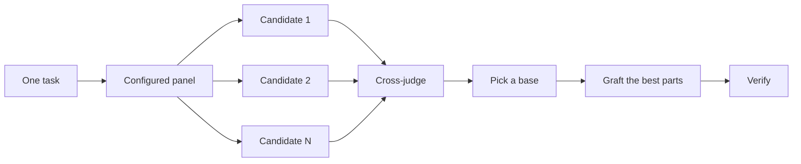

# บทที่ 4: ออกแบบก่อนเขียนโค้ด

การคิดงานออกแบบที่ยากเพียงครั้งเดียว มักทำให้ระบบถูกล็อกอยู่กับโครงสร้างแรกที่โมเดลนึกออก `/architect` ช่วยวาง type และขอบเขตของโมดูลให้ลงตัวก่อนเขียนโค้ดจริง `/arena` สั่งรันหลายๆ แนวทางจากโจทย์เดียวกันแล้วนำจุดดีที่สุดมาหลอมรวมกัน `/interrogate` ส่งโมเดลค่ายอื่นมาพยายามเจาะให้งานนั้นพัง และเมื่อโจทย์เป็นเรื่องการไล่ตรวจให้ครบทุกจุดมากกว่าการสังเคราะห์ดีไซน์ `/swarm` จะกระจายงานออกเป็นชิ้นๆ หรือจัดแข่งกันแล้วสรุปรวมผลกลับมา

ความผิดพลาดด้านการออกแบบที่พบบ่อยที่สุด 2 ข้อ คือ **รับเอาดีไซน์แรกที่ agent เสนอ** และ **ขัดเกลาแผนบนกระดาษที่ยังไม่เคยถูกโค้ดจริงทดสอบ** บทนี้แก้ทั้งสองเรื่อง คุณจะวางแผนผ่านโค้ดจริง ใช้ prototype ตอบคำถามที่ยังเปิดอยู่ ใช้ README หรือ tutorial เป็นเป้า และเขียนแผนฉบับลายลักษณ์อักษรเป็นขั้นตอนสุดท้าย


## ล็อกโครงสร้างให้ลงตัวด้วย `/architect`

```text
/architect design the import pipeline before writing any code. i care most about how callers use it.
```

[`/architect`](../../../skills/architect/SKILL.md) จะไล่ตามทุกระบบที่การเปลี่ยนแปลงนี้ไปแตะก่อน จากนั้นจะร่างโครงสร้างที่ต่างกันขึ้นมา 2 แบบ พร้อม type, signature และขอบเขตโมดูล แล้วเลือกแบบที่ state แต่ละตัวมีเจ้าของเพียงคนเดียว งานแต่ละอย่างมีวิธีทำเพียงทางเดียว และฝั่งผู้เรียกใช้งาน (caller) ต้องรู้น้อยที่สุด สำหรับงานออกแบบที่ใหญ่หรือมีข้อถกเถียงสูง ระบบจะเรียก `/arena` เข้ามาช่วยแทนการร่างคนเดียว หากคุณอยากตรวจดีไซน์ก่อนที่จะมีการเขียนโค้ดใดๆ ให้ระบุลงใน prompt ด้วย

ดีไซน์ไม่ใช่ของศักดิ์สิทธิ์ที่แตะต้องไม่ได้เมื่อเริ่มเขียนโค้ดไปแล้ว ถ้าเจอว่าต้องเขียนโค้ดอ้อมปัญหาเดิมซ้ำไปซ้ำมา `/architect` จะออกแบบใหม่ทั้งก้อนแทนที่จะแปะแผ่นปะแก้ขัดต่อไปเรื่อยๆ

## แตกทางเลือกมาประชันด้วย `/arena`

```text
/arena take my prompt to the arena verbatim. i want to compare their proposals with yours.
```

[`/arena`](../../../skills/arena/SKILL.md) คือเครื่องมือหลักที่อยู่เบื้องหลัง มันส่ง subagent จำนวน N ตัวไปลองทำโจทย์ออกแบบหรือเขียนโค้ดเดียวกันแบบขนาน โดยแต่ละตัวเขียนลงใน worktree หรือโฟลเดอร์ของตัวเอง จากนั้นจะมีกรรมการแบบ read-only จากโมเดลต่างค่ายมาให้คะแนนผู้เข้าแข่งขันทุกตัวตามเกณฑ์ rubric (หากไม่มีโมเดลจากค่ายอื่นให้รัน ตัว coordinator จะข้ามกรรมการและเลือกฐานเอง) เสร็จแล้ว coordinator จะอ่านงานทุกชิ้นตั้งแต่ต้นจนจบ เลือกชิ้นหนึ่งเป็นฐาน (base) ตัดต่อเอาไอเดียที่ดีที่สุดจากตัวที่แพ้มาผสม (graft) แล้วตรวจสอบผลลัพธ์สุดท้าย



รายชื่อโมเดลในคณะกรรมการดึงมาจากการตั้งค่า [`/setup-pstack`](../../../skills/setup-pstack/SKILL.md) ของคุณ และปรับเปลี่ยนเฉพาะงานได้ อยากได้หลายตัวเลือกเมื่อเรื่องนั้นสำคัญ หรือขอน้อยลงเมื่องานไม่ซับซ้อน:

```text
/arena this, 5 candidates. the cache key format is expensive to change later.
```

## ปูพรมตรวจให้ครบหรือแข่งกันด้วย `/swarm`

```text
/swarm check every package under packages/ against its check.sh. one worker per package. one report.
```

[`/swarm`](../../../skills/swarm/SKILL.md) กระจาย worker จำนวน N ตัวออกไปทำงานแยกส่วนอิสระ เช่น coverage matrix, ด่านทดสอบหลายสาย, การแบ่งโซนสำรวจ, หรือการแข่งตามกติกาที่ประกาศไว้ล่วงหน้า worker แต่ละตัวมีขอบเขตและเช็กของตัวเอง แล้วรายงานผลกลับมาเป็น `PASS`, `ISSUES`, หรือ `BLOCKED` ตัวหลักจะรอให้ครบแล้วรวมเป็นรายงานกระชับฉบับเดียวพร้อมระบุช่องโหว่หรือตัวที่หลุดไป

เลือกใช้ `/swarm` เมื่อการทำงานขนานกันช่วยให้ตรวจครอบคลุมขึ้น หรือปล่อยให้เช็กอิสระแข่งกันได้ ต่างจาก `/arena` ที่ส่งทุกตัวไปทำโจทย์ดีไซน์/โค้ดเดียวกัน แล้วค่อยเลือกฐานมาตัดต่อรวมไอเดีย ส่วน `/swarm` แบ่งชิ้นงานหรือแข่งกันโดยมีกติกาตัดสินชัดเจนตั้งแต่ต้น และไม่มีขั้นตอนเลือกฐาน-ตัดต่อ

## จับผิดและลองเจาะให้พังด้วย `/interrogate`

```text
/interrogate the whole branch, but skeptically. no nitpicks unless it's an actual bug or regression.
```

[`/interrogate`](../../../skills/interrogate/SKILL.md) ส่งโค้ดที่แก้พร้อมเจตนาของงานไปให้ฝ่ายตรงข้าม (adversaries) บนโมเดลที่ตั้งค่าไว้ เพื่อให้แต่ละตัวลองเจาะให้พังด้วยการรันทดสอบกับโค้ดจริง โมเดลแต่ละค่ายมักเจอจุดตายต่างกัน ข้อค้นพบจะรอดมาได้ก็ต่อเมื่อรันคำสั่งซ้ำแล้วเห็นความล้มเหลวที่ขัดกับเจตนาของงานจริงๆ รายงานจะแยกแสดงข้อค้นพบที่พิสูจน์แล้ว (พร้อมชื่อโมเดลที่เจอ) ตามด้วยรายการที่ถูกปัดตกไปพร้อมเหตุผล และจะยังไม่แก้ไขโค้ดใดๆ

อย่าลืมอ่านรายการที่ถูกปัดตก (Dropped list) ด้วย เพราะคุณสามารถกลับคำตัดสินได้เสมอ

## ทำ Prototype แทนการมานั่งเถียงกัน

อย่ารีบคว้าดีไซน์แรก ขอสัก 2-3 ตัวเลือก แล้วเลือกจากหลักฐานที่เห็นกับตา:

```text
/poteto-mode prototype a few options for the new dropdown menu. take screenshots or videos for me to compare.
```

[Prototype playbook](../../../skills/poteto-mode/playbooks/prototype.md) จะสร้างโค้ดทดลองแบบใช้แล้วทิ้งไว้ในโฟลเดอร์ชั่วคราว ใส่ตัวสลับให้เลือกดูได้หลายแบบ กดใช้งานจริงทุกตัว แล้วเก็บภาพหน้าจอหรือค่าเวลาเทียบกัน วิธีนี้ใช้ได้กับพฤติกรรมและอัลกอริทึมด้วย ไม่ใช่แค่ UI เท่านั้น Prototype คือการวางแผนด้วยโค้ด มันช่วยให้ agent ตอบคำถามที่ยังค้างคาด้วยการลองรันดูจริงๆ แทนที่จะหันมาถามคุณ และเปิดโอกาสให้คุณเห็นทางเลือกที่ตัวเองอาจนึกไม่ถึง

แนวคิดนี้ขยายไปใช้กับดีไซน์ใหญ่ระดับจริงจังได้ แค่จับคู่ `/architect` กับ prototype และวางด่านให้คุณรีวิวก่อน:

```text
/poteto-mode we need rate limiting for external webhooks. /architect it first, and answer open questions with prototypes. let me review before proceeding.
```

อย่าเอาโมเดลฝ่ายจับผิดไปเสียเวลากับแผนลอยๆ ที่ยังไม่มีโค้ด `/interrogate` จะปัดตกทุกข้อท้วงติงที่รันพิสูจน์ไม่ได้ ดังนั้นแผนที่ยังไม่มีโค้ดรองรับจึงไม่มีอะไรให้ทดสอบเจาะ ปล่อยให้ prototype เคลียร์คำถามให้จบก่อน แล้วค่อยมารีวิวของที่สร้างขึ้นจริง

## เขียน README ก่อนสำหรับโค้ดที่คนอื่นใช้ร่วม

สำหรับ package หรือ API ที่โค้ดส่วนอื่นต้องเรียกใช้ ให้เริ่มจากเอกสารที่ผู้ใช้งานจริงจะต้องอ่าน:

```text
/poteto-mode write a tutorial for how i would use the new config package first. then /teach me why it beats the current one.
```

การเขียน tutorial ก่อนเป็นการบังคับให้มองจากมุมของผู้เรียกใช้งาน (caller) คุณอธิบายวิธีใช้ API ให้ผู้ใช้งานสมมติฟัง แล้วค่อยย้อนกลับมาออกแบบโค้ดข้างใน นอกจากนี้เอกสารดังกล่าวยังกลายเป็นเป้าหมายรูปธรรมให้ agent ใช้ตรวจงานตัวเองด้วย ระบุ [`/technical-writing`](../../../skills/technical-writing/SKILL.md) เมื่อคุณภาพของเอกสารสำคัญ เพื่อให้ tutorial ยังคงความเป็น tutorial ไม่ไหลไปปนกับ reference และคำอธิบาย

## วางแผนหลังจากที่ Design นิ่งแล้ว

pstack จงใจ **ไม่มี** planning skill แยกต่างหาก เมื่อไหร่ที่คุณอยากได้แผนเป็นลายลักษณ์อักษร ให้ขอหลังจากที่โครงสร้างดีไซน์ลงตัวแล้ว:

```text
/poteto-mode turn this design into a plan. small verifiable PRs, each with its own verification steps.
```

[Multi-phase plan playbook](../../../skills/poteto-mode/playbooks/multi-phase-plan.md) จะเคลียร์คำถามที่ยังค้างด้วย prototype ให้หมดก่อน แล้วค่อยเขียนแผนแยกเป็น 1 หัวข้อต่อ 1 PR โดยแต่ละ PR ต้องจบด้วยการพิสูจน์ว่าใช้งานได้จริง (แค่ test suite ผ่านอย่างเดียวยังไม่นับเป็นหลักฐาน) ตัวแผนคือสิ่งส่งมอบสุดท้าย playbook นี้จะยังไม่ลงมือทำจริง และจะเริ่มทำต่อเมื่อคุณสั่งลุยเท่านั้น

สำหรับงานย้ายระบบ (migration) ให้ระบุมาตรฐานความเหมือนไว้ใน prompt ด้วย:

```text
/poteto-mode plan the migration of our ui library to the new styling system. small verifiable PRs, each with visual regression checks. the result must match the original exactly, bugs included.
```

วลี "bugs included" (รวมบั๊กเดิมด้วย) ช่วยป้องกันไม่ให้การย้ายระบบแอบแก้พฤติกรรมไประหว่างทาง จนเอาผลลัพธ์เก่ากับใหม่มาเทียบกันไม่ได้ สำหรับโปรเจกต์ที่ทำต่อเนื่องหลายวัน คุณสามารถ commit ไฟล์แผนไว้ใน repo ชั่วคราวเพื่อให้ agent ตัวอื่นเห็นภาพรวมที่กำลังทำ แล้วค่อยลบทิ้งเมื่องานทั้งหมด merge เสร็จ

## งานหนึ่งชิ้นสมควรออกแบบลึกแค่ไหน?

คุณอาจสงสัยว่าทุกงานต้องทำขนาดนี้เลยไหม คำตอบคือไม่ งานส่วนใหญ่ไม่ต้องใช้อะไรพวกนี้เลย ไล่ระดับคร่าวๆ ดังนี้:

- งานเล็กที่ทำเสร็จแล้วแต่ยังไม่มั่นใจ → ใช้แค่ `/interrogate`
- งานที่ข้ามขอบเขตฟังก์ชันหรือเปลี่ยนเจ้าของ state → ใช้ `/architect` (ซึ่งจะเรียก `/arena` เองเมื่อดีไซน์ใหญ่หรือมีข้อถกเถียง)
- การตัดสินใจแบบเดี่ยวที่อยากได้หลายไอเดียมาเทียบ เช่น การตั้งชื่อ, รูปแบบข้อมูล, หรืออัลกอริทึม → ใช้ `/arena` โดยตรง
- งานตรวจให้ครบทุกส่วนแบบ matrix, งานรันเช็กขนาน, หรือแข่งกันแบบมีกติกาชัด → ใช้ `/swarm`
- คำถามเปิดที่ตอบได้ด้วยการลองรัน เช่น layout, timing, หรือแนวทางเทคนิค → ทำ prototype ไม่ใช่มานั่งถกเถียง
- ดีไซน์ที่ถกเถียงกันหนักและแก้กลับแพง → ใช้ `/architect` แล้วตามด้วย `/interrogate` ก่อนส่งขึ้น
- งานที่ลากยาวหลาย PR → เขียนแผน (plan) หลังจากที่ design นิ่งแล้ว

ปกติ `/poteto-mode` ใช้บันไดขั้นนี้อยู่แล้ว งานที่ข้ามขอบเขตฟังก์ชันจะเรียก `/architect` เองโดยอัตโนมัติ คุณจึงหยิบชื่อเหล่านี้มาใช้ตรงๆ เฉพาะเวลาที่อยากเพิ่มหรือลดความเข้มงวดจากค่ามาตรฐาน

บทถัดไป: [บทที่ 5: ลงมือสร้างและทำความสะอาด diff](./05-build-and-clean.md)

---

## สรุปท้ายบท

- **แก่นของบทนี้:** อย่ายึดติดดีไซน์แรก และอย่าเอาแผนบนกระดาษมาเถียงกันโดยไม่มีโค้ดจริงมารองรับ
- **แยกเครื่องมือคู่แฝดให้ชัด:**
  - `/architect` = วาง boundary & data shape ก่อนเขียน
  - `/arena` = หลายโมเดลทำโจทย์เดียวกัน แล้วหยิบชิ้นดีสุดเป็นฐาน + ตัดต่อไอเดียเด่นจากตัวอื่น
  - `/swarm` = แบ่งชิ้นงานทำขนานกัน (coverage / race) แล้วรวมรายงานเดียว
  - `/interrogate` = ส่งโมเดลค่ายอื่นมาลองเจาะให้พังด้วยการรันจริง
- **เคล็ดลับมืออาชีพ:** ใช้ **Prototype** ตอบคำถามที่ทดสอบได้จริง และ **เขียนแผนเป็น PR ย่อยๆ** หลังจาก design นิ่งแล้วเท่านั้น
