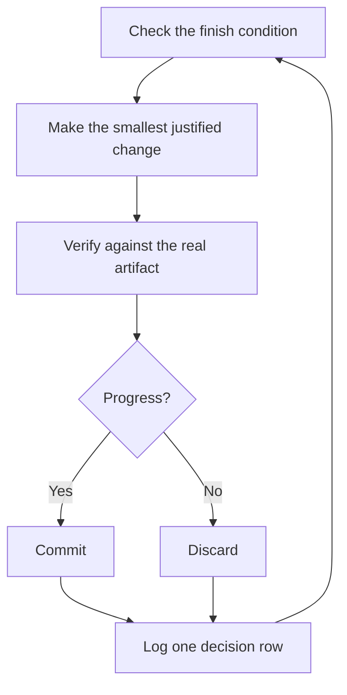

# บทที่ 7: ปล่อยให้ระบบทำงานตอนคุณหลับ

นี่คือผลตอบแทนของทุกบทที่ผ่านมา Agent ที่คุณไว้ใจให้ตรวจสอบงานตัวเองได้ คือ agent ที่คุณปล่อยให้อยู่กับงานยากได้ตามลำพัง สิ่งที่ทำให้มันปลอดภัยไม่ใช่ความหวังลมๆ แล้งๆ แต่คือ **เงื่อนไขจบงานที่เช็กได้, worktree หรือ cloud agent ที่แยกขาดจากกัน, และ decision log ที่คุณเปิดตรวจได้ในตอนเช้า**


## สร้างความเชื่อใจก่อนเปิด Loop

ลูปที่คุณยังไม่ไว้ใจมีแต่จะปั่นงานที่ไม่ได้ตรวจออกมาเร็วขึ้น และความเละเทะจะทวีคูณขึ้นในทุกรอบ ก่อนปล่อยให้มันรันข้ามคืน ให้เช็กก่อนว่ามันสอบผ่านครบทั้ง 4 ข้อหรือยัง:

- คุณเคยทำงานนั้นด้วยมือมาแล้ว 1 รอบ หรือเฝ้าดู agent ทำมาก่อน จนรู้ว่า "หน้าตาของงานที่ดี" เป็นอย่างไร
- agent มีเครื่องมือและสัญญาณแบบเดียวกับที่คุณใช้เอง ทั้ง verification skill, profiler, และ logs
- ทุกขั้นตอนพิสูจน์งานตัวเองได้ และหยุดสายพานได้เมื่อผลงานต่ำกว่าเกณฑ์
- คุณเคยอ่าน transcript ของรันก่อนๆ และแปลงความผิดพลาดซ้ำๆ ให้เป็นเครื่องมือ, skill, หรือตัวเช็กเรียบร้อยแล้ว

เปิดรันแบบอัตโนมัติเฉพาะเมื่อครบทั้ง 4 ข้อเท่านั้น ก่อนหน้านั้นให้รันโดยที่คุณนั่งดูไปด้วย

## สัญญางานข้ามคืน (The overnight contract)

การส่งต่องานที่ดีต้องมี เป้าหมาย, เงื่อนไขจบงาน, สิทธิ์อนุญาต, และทางหนีทีไล่ ไม่จำเป็นต้องเขียนยาว:

```text
/poteto-mode im going to bed. migrate every caller to the new parser in a fresh worktree off <base>.
done means zero old callers, all parser fixtures pass, old api deleted.
keep a decision log. don't ask me before committing.
/loop until done. if you're truly stuck after a few hours, stop and write up why.
```

มาดูกันว่าแต่ละบรรทัดซื้ออะไรให้คุณบ้าง:

- `"im going to bed"` เป็นคำสั่งปลดล็อกประจำ session ทำให้ agent หยุดถามจุกจิกและเดินหน้าต่อ
- `"done means..."` แปลงเป้าหมายให้เป็นชุดตรวจที่ทุกรอบของลูปสามารถรันเช็กได้
- `"fresh worktree off <base>"` กันไม่ให้งานนี้ไปชนกับงานอื่นที่คุณเปิดค้างอยู่
- `"don't ask me before committing"` ตอบคำขออนุญาตล่วงหน้า ในจุดที่ปกติ agent จะหยุดรอถามคุณ
- `/loop` เป็นกลไกปลุกงานของ Cursor เอง ไม่ใช่ skill ของ pstack โดย [Autonomous run playbook](../../../skills/poteto-mode/playbooks/autonomous-run.md) จะใช้มันคอยเช็กเงื่อนไขจบงานตาม event หรือ heartbeat
- ทางหนีทีไล่ (`if you're truly stuck...`) เปิดทางให้มันหยุดเมื่อเจอทางตันจริงๆ แล้วเขียนสรุปสาเหตุไว้ ดีกว่าปล่อยให้มันตีความเป้าหมายใหม่แบบสร้างสรรค์ไปเรื่อยๆ นาน 8 ชั่วโมง

เพราะงานนี้คุณจะกลับมาตรวจทีหลัง `/poteto-mode` จึงส่งผ่าน [`/figure-it-out`](../../../skills/figure-it-out/SKILL.md) เพื่อวางเฟสของงานก่อนแตะโค้ด และเสียบ decision log เข้าไปในกระบวนการ

หากต้องการสั่งหยุดกลางคันอย่างจงใจ ให้บอก agent ให้หยุดพัก (pause) หรือบอกว่ากำลังจะออฟไลน์/รีสตาร์ทเครื่อง [Pause safely playbook](../../../skills/poteto-mode/playbooks/pause-safely.md) จะทำขั้นตอนปัจจุบันให้จบหรือถอยกลับให้สะอาด commit จุดพักแบบ work-in-progress แล้วเขียนบันทึกสำหรับสานต่อ (resume note) แชทใหม่สามารถมาหยิบงานต่อจากบันทึกนั้นผ่าน Session pickup playbook ได้ทันที ส่วนคำสั่ง `"keep going"` จะไม่มีวันไปกระตุ้นการ pause

## สิ่งที่ Loop ทำตลอดทั้งคืน



1 การแก้, 1 การตรวจ, 1 แถวบันทึก ในทุกรอบ การแก้ที่ไม่ช่วยให้ดีขึ้นจะถูกโยนทิ้ง ไม่ปล่อยให้ค้างติดโค้ดไปต่อ ถ้ากราฟนิ่งไม่ขยับ (plateau) แปลว่าต้องเปลี่ยนแนวทาง ไม่ใช่หยุด และเงื่อนไขจบงานจะไม่มีวันแอบลดสเปกลงมาเพื่อประกาศชัยชนะเด็ดขาด

## การตรวจรับงานตอนเช้า

[`/show-me-your-work`](../../../skills/show-me-your-work/SKILL.md) คือสิ่งที่ทำให้รันข้ามคืนตรวจสอบย้อนหลังได้ แต่ละแถวจะบันทึก เวลา, เฟส, การตัดสินใจ, เหตุผล, ลิงก์หลักฐาน, และผลลัพธ์ ลงในไฟล์ TSV ที่ `decisions.tsv` (หรือ `.audit/<task-slug>.tsv` เมื่อหลายงานใช้โฟลเดอร์ร่วมกัน) โดยค่าเริ่มต้นจะเก็บไว้แบบ local เท่านั้น ให้ commit ลง repo เฉพาะเมื่องานนั้นใหญ่และสำคัญพอที่ reviewer จะต้องอาศัยปูมนี้เพื่อวางใจในผลลัพธ์

เมื่อคุณกลับมา ให้เรียกดูรายงานในโหมดตรวจรับงาน:

```text
/show-me-your-work catch me up on what you did last night
```

ก่อนที่ skill จะส่งสรุปกลับมา มันจะเรียก reviewer จากโมเดลคนละค่ายมาอ่านปูมตัดสินใจและ transcript ทั้งหมด แล้วจบรายงานด้วยหัวข้อ `Attention` ที่ลิสต์เฉพาะจุดที่น่าสงสัยและควรค่าแก่การเพ่งเล็งของคุณ อ่านหัวข้อนั้นก่อน แล้วค่อยไล่ดูแถวบันทึกที่มันชี้ไป คุณกำลังตรวจ "การตัดสินใจ" ไม่ได้มานั่งอ่านประวัติทั้งคืน

แต่ถ้าแค่อยากได้สรุปสถานะไวๆ แทนการ audit เต็มรูปแบบ ให้รัน [`/ketchup`](../../../skills/ketchup/SKILL.md) ในแชทที่รันงานนั้น มันจะอ่านอย่างเดียวแล้วเล่าให้คุณฟังด้วยภาษาคนง่ายๆ ว่ามีอะไรเปลี่ยนไปบ้างตั้งแต่ข้อความล่าสุดของคุณ พร้อมภาพหน้าจอและแผนภาพเล็กๆ ที่งานนั้นสร้างไว้ จากนั้นจะลิสต์เรื่องที่รอคุณตัดสินใจ (เช่น การ merge, การอนุมัติ, หรือการเลือกทางออก) พร้อมตัวเลือกที่แนะนำ หลักฐาน และความเสี่ยง เพื่อให้คุณตัดสินใจได้จบจากคำตอบนั้นเลย

## เมื่อคืนนั้นไม่ได้มีแค่งานเดียว แต่มีเป็นคิว

สัญญาด้านบนใช้ขับเคลื่อน 1 งานไปสู่ 1 เงื่อนไขจบงาน แต่บางคืนคุณมีมากกว่านั้น เช่น คิวของงานย่อยที่อิสระต่อกัน หรือโครงการใหญ่ทั้งก้อน เรามี 2 playbooks และ 1 skill ที่ขยายความเชื่อใจเดิมขึ้นไปอีกระดับ

[Autopilot-full](../../../skills/poteto-mode/playbooks/autopilot-full.md) รันคิวของ PR ที่เป็นอิสระต่อกันไปจนถึงขั้น **merge** โดยแต่ละ PR จะมี owner agent 1 ตัวรับผิดชอบตั้งแต่สร้างจน merge แต่ไม่มี owner ตัวไหนกด merge จากคำตัดสินของตัวเองได้ ฝูง verifier ตัวใหม่ (swarm) จะมาตรวจ head ที่พร้อมส่งของ owner หากมีการ rebase หรือแก้จุกจิกทีหลังก็ส่ง verifier ตัวใหม่ 1 ตัวมาเช็กซ้ำ และถ้ามีการเปลี่ยนพฤติกรรมหรือ diff ก้อนใหญ่จึงค่อยเรียก swarm เต็มรูปแบบอีกครั้ง เฉพาะผลผ่านที่สะอาดบน patch ตัวที่จะ merge เท่านั้นจึงจะอนุมัติให้ merge ได้:

```text
/poteto-mode full autopilot on this queue. each item is independent. i want them merged by morning.
```

[Autopilot-stack](../../../skills/poteto-mode/playbooks/autopilot-stack.md) คือ Autopilot-full ที่ **ตัดขั้นตอน merge ออก** คุณตื่นมาเจอ PR ที่ผ่านการตรวจพร้อมคำตัดสินครบทุกตัว แล้วคุณค่อยรีวิวและกด land ด้วยตัวเอง PR จะ stack ต่อจาก PR อื่นเฉพาะเมื่อมันต้องต่อยอดจากโค้ดของตัวนั้นจริงๆ เลือกใช้ตัวนี้แทน Autopilot-full เมื่อคุณอยากเห็นงานด้วยตาตัวเองก่อนจะ merge อะไรลง main:

```text
/poteto-mode autopilot these five changes, but don't merge. i'll land them in the morning.
```

สำหรับโครงการใหญ่ทั้งก้อน เช่น การย้ายระบบข้ามหลาย package จะไม่มี playbook เฉพาะของตัวเอง `/poteto-mode` จะส่งงานใหญ่หรือข้ามหลายส่วนไปยัง [`/figure-it-out`](../../../skills/figure-it-out/SKILL.md) เพื่อออกแบบรันที่รัดกุมเฉพาะงานนั้นขึ้นมาให้:

```text
/poteto-mode migrate every package to the new store. own it until each one is converted and merged. i'll check in twice a day.
```

## รันหลายโปรเจกต์ขนานกัน

[Cursor Project](https://cursor.com/blog/projects) ให้ coordinator agent หนึ่งตัวมีเธรดต่อเนื่องระยะยาว ตัว coordinator ไม่ได้เขียนโค้ดเอง แต่ทำหน้าที่สั่ง subagent ซึ่งค่าเริ่มต้นจะรันบน cloud งานจึงเดินต่อได้แม้คุณปิดฝาโน้ตบุ๊กแล้ว ให้ขึ้นต้นคำสั่งถึง coordinator ด้วย `/poteto-mode` แล้ว subagent ที่มันเรียกออกมาจะเดินตาม playbook เอง และทุก agent ที่ถูกปลุกขึ้นมาจะอ่าน [`worker.md`](../../../skills/poteto-mode/worker.md) เป็นอันดับแรก พวกมันจึงยึดเกณฑ์ของงานที่ได้รับ ตัดสินใจเรื่องที่ย้อนกลับได้เองโดยไม่ทักมาถามคุณ และเปิด PR แบบพร้อมรีวิว

นิสัยเล็กๆ ที่ช่วยให้ระบบนี้ลื่นขึ้น:

- แยกงานแต่ละสายเป็น Project ของตัวเอง เช่น 1 ฟีเจอร์, 1 migration, 1 รอบจูน perf, หรือ 1 รอบเคลียร์ tech-debt แล้วปล่อยรันคู่ขนานกันไป
- ลากแชทที่เกี่ยวข้อง (รวมถึงแชทที่จบไปแล้ว) เข้ามาใน Project เพื่อใช้เป็นบริบทกลางให้ agent ทุกตัว
- ให้ PR ทุกใบผ่าน verification swarm ก่อน merge แล้วปล่อยให้ Autopilot-stack หรือ Autopilot-full วิ่งตามคิว
- สั่ง coordinator ให้ทำแผนที่อิงจากข้อมูลจริง และให้ใช้ prototype ตอบคำถามที่ยังเปิดอยู่ก่อนจะมาถามคุณ

prompt เดียวสามารถขับเคลื่อน Project ทั้งก้อนตั้งแต่ช่วงวิจัยจนถึงลงมือทำได้เลย:

```text
/poteto-mode refactor this repo so its architecture is more agent friendly. use /correct and /architect on past commits and review comments to find the mistakes agents make most here. use /recall for context from past chats. answer open questions with prototypes instead of asking me. come back with a plan backed by real data. once i approve it, run it with autopilot-stack or autopilot-full, and ask me which.
```

## ปล่อยให้ Loop สตาร์ทตัวเองอัตโนมัติ

loop ทั้งหมดข้างต้นยังต้องรอให้คุณเป็นคนกดเริ่ม การตั้ง automation แบบตามเวลา (scheduled) หรือตามเหตุการณ์ (event-driven) จะตัดขั้นตอนนี้ทิ้ง งานดูแลรักษาระบบแบ่งเป็นขั้นที่เหมาะกับวิธีนี้มาก ได้แก่ คัดแยก (triage) รายงานปัญหา → จำลองให้พัง (repro) → แก้ → พิสูจน์การแก้ กฎ 2 ข้อที่ทำให้สายพานนี้เชื่อถือได้:

- **ทุกด่านต้องหยุดสายพานได้:** ด่าน triage ตัดสินได้ว่าอาการที่แจ้งเป็นพฤติกรรมปกติ, ด่าน repro ยืนยันได้ว่าจำลองให้พังไม่สำเร็จ, และคนแก้ประเมินได้ว่าการแก้เสี่ยงเกินไป ผลลัพธ์เหล่านี้มีประโยชน์ทั้งหมด เพราะมันสกัดงานเสียไม่ให้ไหลไปด่านถัดไปซึ่งแก้ไขแพงกว่า
- **ทุกด่านต้องส่งต่อหลักฐาน:** ด่าน repro แนบภาพและวิดีโอของอาการพัง และด่านแก้แนบหลักฐานก่อน-หลัง คนจึงตรวจได้ว่า agent แก้ถูกจุดตั้งแต่ยังไม่ทันอ่านโค้ดสักบรรทัด

pstack มีชุด [automation pack](../../../automations/benny/README.md) ที่ปิดพักไว้ให้สำหรับรับรายงานปัญหาจาก Slack ตัวหนึ่งคัดแยกแต่ละรายงาน อีกตัวจำลองบั๊กที่ยืนยันแล้วและอาจเตรียม draft fix เล็กๆ ไว้ให้ แค่ชี้ agent ไปที่ไฟล์ [`FOR_AGENTS.md`](../../../automations/benny/FOR_AGENTS.md) แล้วระบุชื่อ repo เป้าหมายเพื่อตั้งค่าใช้งาน

**กับดัก:** ระยะเวลาไม่ใช่เงื่อนไขจบงาน `"work on this for 4 hours"` ไม่ได้ให้อะไร agent เอาไว้เช็ก และคุณจะตื่นมาเจอกับ "ความเคลื่อนไหว 4 ชั่วโมง" แทนที่จะได้ "ผลลัพธ์" จงให้เงื่อนไข (predicate) ที่ตัดสินผ่านหรือตกได้เสมอ

บทถัดไป: [บทที่ 8: คุมทิศทางด้วยชื่อ Principle](./08-principles.md)

---

## สรุปท้ายบท

- **แก่นของบทนี้:** ความปลอดภัยของงานข้ามคืนไม่ได้มาจากดวง แต่มาจาก **3 เสาหลัก:** เงื่อนไขจบงานที่ตรวจได้ + worktree/VM ที่แยกขาด + ปูมตัดสินใจ (`/show-me-your-work`) ที่โมเดลค่ายอื่นช่วยตรวจซ้ำตอนเช้า
- **อย่าปล่อยอัตโนมัติจนกว่าคุณจะทำเองได้ 1 รอบ:** ต้องมี verification skill, ต้องหยุดเมื่อตกเกณฑ์ได้, และต้องไม่แก้เกณฑ์เพื่อให้ผ่าน
- **ขยายสเกลด้วย:** `Autopilot-stack` (ตรวจครบแต่รอคุณกด merge เอง) vs `Autopilot-full` (ผ่าน swarm verify แล้ว merge อัตโนมัติ) และ `Pause safely` เมื่ออยากหยุดกลางคันอย่างปลอดภัย
