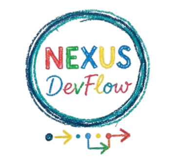
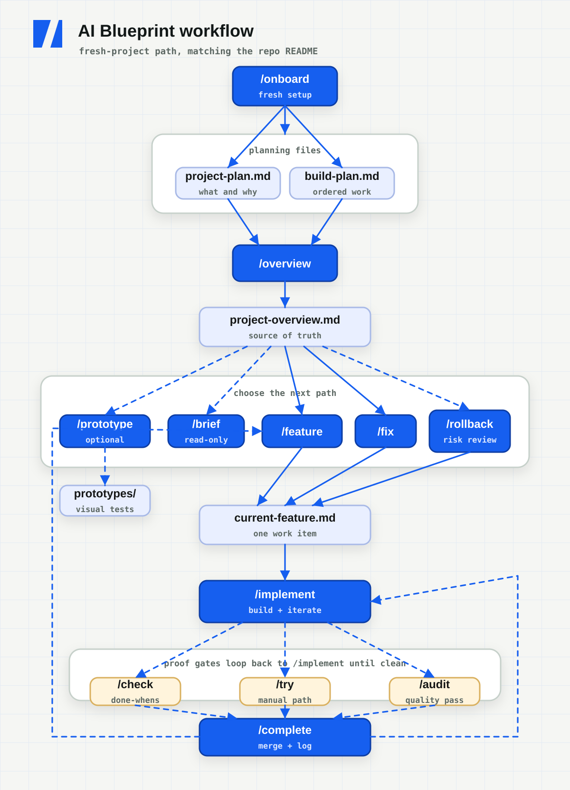

<p align="center">
  
</p>

<h1 align="center">Nexus-DevFlow</h1>

<p align="center"><strong>A file-backed, spec-driven workflow layer with The 3-Pillars Architecture & Single Living Spec Model for building production software with AI while staying in control.</strong></p>

<p align="center">
  <a href="https://jakkrich.github.io/nexus-devflow/"></a>
  <a href="https://www.npmjs.com/package/nexus-devflow"></a>
  <a href="https://github.com/Jakkrich/nexus-devflow/actions/workflows/validate.yml"></a>
  <a href="LICENSE"></a>
</p>

<p align="center"><strong>English</strong> | <a href="README.th.md">ไทย</a></p>

<p align="center">
  <a href="https://jakkrich.github.io/nexus-devflow/">📖 Documentation Website</a> |
  <a href="https://github.com/Jakkrich/nexus-devflow">Repository</a> |
  <a href="https://www.npmjs.com/package/nexus-devflow">npm</a> |
  <a href="https://github.com/Jakkrich/nexus-devflow/releases">Releases</a> |
  <a href="CHANGELOG.md">Changelog</a>
</p>

You capture ideas, architectural decisions, and product requirements in structured markdown documents. The AI transforms them into project context, single living feature specs, and granular TDD execution steps. You build one feature at a time, review every spec before code exists, and review every diff and test verification before it lands.

Install it inside an already scaffolded or existing Git repository in seconds:

```bash
npx -y nexus-devflow -y
```

> [!TIP]
> 📖 **Official Documentation**: Explore our interactive guides, architectural maps, and complete command reference at [https://jakkrich.github.io/nexus-devflow/](https://jakkrich.github.io/nexus-devflow/).

> [!NOTE]
> Nexus-DevFlow is designed as a non-intrusive workflow layer that overlays on top of your application codebase, bringing multi-agent skills (`.agents/skills` & `.claude/skills`), structured context (`devflow/`), and senior QA gates to your favorite AI IDE (**Google Antigravity**, **Claude Code**, **OpenAI Codex**, **Cursor**, **GitHub Copilot**, **Gemini CLI**, **Aider**, **OpenCode**, and others).

---

## What this is

Vibe coding is describing a vague idea and blindly accepting whatever the AI returns. It feels fast initially, but quickly leads to unmaintainable spaghetti code, regression debt, and fragile software that cannot be safely refactored.

**Nexus-DevFlow** provides a disciplined, controlled engineering loop:

1. **Spec before code.** Planning skills write a complete living spec and pause. You review scope, data contracts, and edge cases before a single line of code is written.
2. **Small, reviewable TDD steps.** Each implementation step enforces strict Red-Green-Refactor discipline with an observable diff, test proof, and empirical verification.
3. **One work item at a time.** `devflow/context/current-feature.md` holds exactly one feature, fix, or rollback as a Single Living Spec. Finish it, archive it to `devflow/history/`, and move on.
4. **Findings & Quality Gates with teeth.** Review findings get durable IDs in a persistent ledger (`findings.md`), and critical findings (P0/P1) block release until verified or explicitly waived on the record. Nothing gets lost when context clears.

The goal is not just writing code faster—it is staying firmly in control of a production codebase built with AI assistance.

---

## At a glance

| Principle | What it means |
| :--- | :--- |
| **Spec first** | The AI writes a structured living spec and pauses for developer review before code is created. |
| **Strict TDD discipline** | Implementation progresses through `[TDD-Red]`, `[TDD-Green]`, and `[TDD-Refactor]` steps with verified test logs. |
| **The 3-Pillars Workspace** | Clean separation of Future (`ideas.md`), Present (`context/`), and Past (`history/` & `decisions/`). |
| **Findings gate** | `/audit` findings live in `findings.md` with durable IDs; unresolved P0/P1 issues strictly block `/complete`. |
| **Universal tool adapters** | Antigravity, Claude Code, OpenAI Codex, Cursor, GitHub Copilot, and OpenCode share compatible skills. |
| **Real-time observability** | Instant CLI status (`nexus-devflow status`), 11-tool MCP server (`nexus-devflow mcp`), Multi-Agent Swarm, and Code Graph RAG. |
| **Zero-drop context** | Markdown-backed state survives AI context window resets and agent session restarts. |

---

## Contents

- [What this is](#what-this-is)
- [At a glance](#at-a-glance)
- [Quick start](#quick-start)
  - [Already have a codebase?](#already-have-a-codebase)
  - [Keep DevFlow current](#keep-devflow-current)
  - [Check project status](#check-project-status)
- [Tool support](#tool-support)
- [The AI workflow](#the-ai-workflow)
- [See it in action](#see-it-in-action)
- [Visual overview](#visual-overview)
- [The 3-Pillars Workspace Architecture](#the-3-pillars-workspace-architecture)
- [The Single Living Spec Model](#the-single-living-spec-model)
- [Pre-Flight Discovery & Architectural Alignment](#pre-flight-discovery--architectural-alignment)
- [What gets generated](#what-gets-generated)
- [Using the workflow](#using-the-workflow)
  - [Fixes](#fixes)
  - [Rollbacks](#rollbacks)
- [Command reference](#command-reference)
  - [Autopilot](#autopilot)
- [Automatic GitHub checks](#automatic-github-checks)
- [Testing & Strict TDD Discipline](#testing--strict-tdd-discipline)
- [Code quality audits & Findings ledger](#code-quality-audits--findings-ledger)
- [Manual try guides](#manual-try-guides)
- [CLI Management Commands](#cli-management-commands)
- [Recommended Third-Party Skills & Extensions](#recommended-third-party-skills--extensions)
- [Deployment readiness](#deployment-readiness)
- [Picking up where you left off](#picking-up-where-you-left-off)
- [File map](#file-map)
- [Documentation and governance](#documentation-and-governance)
- [Support and contributing](#support-and-contributing)
- [License](#license)
- [Notes](#notes)

---

## Quick start

Scaffold your application first, then overlay Nexus-DevFlow.

**Prerequisites:**
- Node.js 20 or newer
- An application scaffolded with your preferred stack (Next.js, Vite, NestJS, Python, Go, etc.)
- A Git repository initialized for that application

> [!IMPORTANT]
> Scaffold your application first, then install Nexus-DevFlow. Do not run a framework scaffolder inside a directory that already contains DevFlow workflow files.

### 1. Scaffold your app
In a new, empty directory (Next.js is used here as an example):

```bash
npx create-next-app@latest my-app
cd my-app
git init
```

### 2. Add Nexus-DevFlow
Run the non-intrusive installer from the project root:

```bash
npx -y nexus-devflow -y
```

The installer configures multi-agent skill adapters (`.agents/skills/` and `.claude/skills/`), sets up the `devflow/` workspace, and updates `AGENTS.md` and `CLAUDE.md`.

### 3. Run onboard before anything else
Run `/onboard` to detect your stack, configure test commands, verify git conventions, and align standards:

```text
/onboard
```

*(In Google Antigravity / Claude Code: `/onboard` | In OpenAI Codex: `$onboard` | In Cursor/Copilot: ask the agent to run onboard)*

### 4. Review the setup
Inspect the generated configuration files:
- `devflow/context/coding-standards.md` — customize code conventions, lint rules, and test gates.
- `devflow/context/ai-interaction.md` — adjust AI operational preferences and communication rules.

If something feels misconfigured, run `/devflow doctor` for an instant read-only health check.

### 5. Plan & Capture Ideas
Capture initial requirements, user stories, or raw thoughts:
- Add high-level concepts into `devflow/ideas.md` or use `/idea` for AI feasibility scoring.
- Run `/discovery --grill` to stress-test architecture and record Decision Records (`devflow/decisions/`).
- Run `/discovery` for deep multi-turn domain exploration or SA doc intake.

### 6. Generate the project overview
Run `/overview` to distill your planning notes into `devflow/context/project-overview.md`, which serves as the AI's source of truth:

```text
/overview
```

### 7. Repeat the build loop
Once your overview is generated, deliver one feature or fix at a time:

```text
/feature -> review spec -> /implement -> /check -> /audit current -> /complete
```

---

### Already have a codebase?

If you are bootstrapping DevFlow into an existing brownfield application with shipped features, `/onboard` automatically detects brownfield repositories (or invoke `/onboard --adopt`):

```text
/onboard --adopt
```

Brownfield adoption in `/onboard` surveys your codebase, preserves your existing README, detects existing test runners and CI workflows, and generates baseline planning docs and coding standards from what is already running.

---

### Keep DevFlow current

Check for updates without modifying files:

```bash
npx nexus-devflow update --check
```

Apply managed updates safely:

```bash
npx nexus-devflow update
```

DevFlow updates only managed workflow skills under `.agents/skills/` and `.claude/skills/`. Your project plans, living specs, context, history, and source code are never overwritten.

In interactive terminals, Step `[3/3]` (`Configuring Extras Skills...`) displays a multi-select checkbox (`↑`/`↓`, `Space`, `a`, `Enter`, `Esc`) for the 7 bundled opt-in extras skills (`setup-tests`, `ci`, `release`, `rollback`, `vendor`, `convert-any-to-md`, `browseros-neo`), pre-checking already-installed skills on `update` without removing unticked ones (skipped automatically under `--yes`, `--dry-run`, or non-interactive runs).

---

### Check project status

Run the read-only CLI status checker at any time:

```bash
npx nexus-devflow status
```

For tool integrations, output structured JSON:

```bash
npx nexus-devflow status --json
```

---

## Tool support

Nexus-DevFlow supports all major AI coding assistants through native adapters:

| Tool / IDE | Support & Location | Invocation Syntax |
| :--- | :--- | :--- |
| **Google Antigravity** | Native project skills in `.agents/skills/` | Slash commands (e.g. `/feature`, `/implement`, `/devflow`) |
| **Claude Code** | Native project skills in `.claude/skills/` | Slash commands (e.g. `/feature`, `/implement`, `/devflow`) |
| **OpenAI Codex CLI** | Native project skills in `.agents/skills/` | Dollar invocation (e.g. `$feature`, `$implement`, `$devflow`) |
| **Cursor / Copilot** | `AGENTS.md` + shared `.agents/skills/` | Prompt by canonical name or follow `SKILL.md` |
| **OpenCode / Windsurf** | Compatible shared skill trees | Direct skill execution on demand |
| **Gemini CLI / Aider** | Shared instructions via `AGENTS.md` | Ask agent to follow matching `SKILL.md` |

---

## The AI workflow

Nexus-DevFlow structures AI development into a disciplined, repeatable engineering loop with clear human review gates and permanent audit logs.

### The Standard Feature Loop

```text
/feature ──▶ review spec ──▶ /implement ──▶ /check ──▶ /audit current ──▶ /complete
```

- **`/feature`**: Allocates sequential ID (`xxx-slug`), defines scope, establishes data contracts, and creates the Single Living Spec (`devflow/context/current-feature.md`).
- **`/implement`**: Builds each task incrementally with strict TDD (`[TDD-Red]`, `[TDD-Green]`, `[TDD-Refactor]`) and logs diff evidence.
- **`/check`**: Senior QA verification across multi-lane test suites (types, lints, unit tests, manual proof).
- **`/audit current`**: Audits branch deltas for code quality, security boundaries, and performance regressions; records findings in `findings.md`.
- **`/complete`**: Final safety check, records Release Digest, archives spec to `devflow/history/features/`, and squash-merges with user approval.

---

### The Fix Loop (Ad-hoc bugs)

For unplanned bugs or small changes:

```text
/fix "issue description" ──▶ review spec ──▶ /implement ──▶ /check ──▶ /complete
```

---

### The Debug Loop (Diagnostics)

When the root cause is unclear, investigate without modifying application state:

```text
/debug "failing test or error" ──▶ review evidence ──▶ /fix "confirmed cause" ──▶ /implement
```

The skills include English JIT guides for root-cause tracing, defense-in-depth,
condition-based waiting, TDD anti-patterns, and two-stage review. See the
[reference-guide usage map](https://jakkrich.github.io/nexus-devflow/workflow-surface-map/)
for when to use each guide, the 3-Strike Rule, and the existing review gates.

---

### The Rollback Loop (Safe Reversals)

To safely revert a completed feature while preserving audit history:

```text
/rollback 054 ──▶ review risk & spec ──▶ /implement ──▶ /check ──▶ /complete
```

Matches the archived spec and squash commit, verifies later dependency risk, and applies only product diffs in reverse without rewriting Git history.

---

## See it in action

DevFlow makes handoffs explicit and reviewable at every stage:

```text
You: Run the next feature: user authentication.
AI:  Created Single Living Spec at devflow/context/current-feature.md (001-user-authentication).
     Defined 3 Acceptance Criteria, 4 TDD tasks. Paused for your review.

You: The spec looks solid. Implement task 1.
AI:  [TDD-Red] Added failing test in auth.test.ts.
     [TDD-Green] Implemented TokenValidator service.
     [TDD-Refactor] Extracted jwt verify helper.
     Diff and test logs attached. Ready for review.

You: Run the check.
AI:  Verified Multi-Lane Matrix: Typecheck ✔, Lint ✔, Vitest (14 passing) ✔.
     Empirical evidence recorded in living spec.

You: Audit current feature.
AI:  Audited branch delta: Quality ✔, Security ✔ (0 vulnerabilities, 0 leaks), Tests ✔.
     Findings ledger clean (0 open blockers).

You: Complete it.
AI:  Recorded Release Digest in living spec.
     Archived to devflow/history/features/001-user-authentication.md.
     Updated devflow/history/HISTORY.md master ledger.
     Ready to squash-merge branch 'feature/001-user-authentication' into main. Proceed? [Y/n]
```

---

## Visual overview & Interactive System Maps

Explore the interactive system architecture and living spec lifecycle generated with **Archify**:

- 🌐 **[Nexus-DevFlow System Architecture Map (Interactive HTML)](docs/diagrams/nexus-devflow-architecture.html)** — Trace the 3-Pillars workspace, multi-agent adapters, and senior QA gates.
- ⚡ **[Nexus-DevFlow Living Spec Lifecycle & State Machine (Interactive HTML)](docs/diagrams/nexus-devflow-lifecycle.html)** — Step through the 4-stage progressive rail (`/feature` ➔ `/implement` ➔ `/check` ➔ `/complete`), blocker gates, and reversals.



1. **Pre-Flight Discovery**: Explore ideas (`/idea`, `/explore`) and conduct deep domain alignment, doc intake, and ADRs (`/discovery` / `/discovery --grill`).
2. **Context Setup**: Run `/onboard` (fresh or brownfield `--adopt`) followed by `/overview` to establish the living source of truth.
3. **Delivery Loop**: Execute `/feature` or `/fix`, build with `/implement`, verify with `/check`, audit with `/audit`, and close with `/complete`.
4. **Permanent Archive**: Completed specs and findings are preserved permanently in `devflow/history/` and `devflow/decisions/`.

---

## The 3-Pillars Workspace Architecture

DevFlow organizes all project intelligence and workflow history into three clean pillars representing **Future**, **Present**, and **Past**:

```text
devflow/
│
├── 🔮 ideas.md                 # [1. Future / Backlog] Centralized Idea Inbox with AI feasibility scoring
│
├── ⚡ context/                  # [2. Present / Active] Living Source of Truth & Active Work
│   ├── project-overview.md     # Primary source of truth for architecture and tech stack
│   ├── coding-standards.md     # Engineering conventions, strict TDD rules, and test gates
│   ├── ai-interaction.md       # AI agent interaction rules and operational preferences
│   ├── findings.md             # Quality, security, and verification findings ledger (P0-P3)
│   ├── current-stage.md        # Active stage run tracker and state pointer
│   └── current-feature.md      # The Single Living Spec (Active delivery spec / idle stub)
│
├── 🏛️ decisions/                # Architecture Decision Records (ADR-xxx-slug.md)
│
├── 📦 history/                  # [3. Past / Completed] Permanent Categorized Delivery Archives
│   ├── features/               # Completed features, migrations, and tooling (xxx-slug.md)
│   ├── fixes/                  # Completed bug fixes, hotfixes, security patches (xxx-slug.md)
│   ├── rollbacks/              # Safely reversed feature records (YYYY-MM-DD-xxx-slug.md)
│   └── HISTORY.md              # Master release history ledger summary table
│
└── 🔍 discoveries/              # Pre-delivery discovery records (DISC-YYYYMMDD-NNN-slug.md)
```

### Why 3 Pillars?
- **Token Efficiency**: Agents only load active context (`devflow/context/`), saving up to 80% token overhead on each prompt.
- **Durable History**: Completed work is archived with full commit references and retrospectives.
- **Survivable Context Resets**: Even if the AI context window clears, active work instantly resumes from `current-feature.md`.

---

## The Single Living Spec Model

Every delivery task operates on `devflow/context/current-feature.md`, structured into **6 standard sections**:

1. **🎯 1. Define & Boundaries**: Problem statement, proposed solution, scope boundaries, and non-breaking invariants.
2. **📐 2. Technical Spec & Contracts**: Data contracts, API schemas, and testable Acceptance Criteria (AC-1..AC-N).
3. **📋 3. Execution Plan & TDD Checklist**: Sequential task breakdown with granular `[TDD-Red]`, `[TDD-Green]`, and `[TDD-Refactor]` sub-tasks.
4. **⚡ 4. Implementation Log & Evidence**: Live engineering log recording step-by-step implementation evidence and diffs.
5. **🧪 5. Multi-Lane Verification Matrix**: Empirical test logs, benchmark data, and manual proof verification.
6. **📦 6. Release Digest & Retrospective**: Release summary, key architectural decisions, and retrospective notes.

---

## Pre-Flight Discovery & Architectural Alignment

Before committing to code, use specialized companion skills to brainstorm, stress-test, and align on complex requirements:

```text
/idea (Inbox) ──▶ /explore (Options) ──▶ /discovery (Explore & ADR) ──▶ /feature (Deliver)
```

- **`/idea`**: Quick capture of raw ideas into `devflow/ideas.md` with automatic AI scoring across Feasibility, Effort, and Business Value.
- **`/explore`**: Read-only exploration and structured option comparison (`brainstorm` mode: 2–3 options + trade-off matrix) grounded in existing code without modifying files.
- **`/discovery`**: Unified discovery engine supporting Macro Roadmap Planning, Micro Pre-Flight (`devflow/discoveries/DISC-xxx/discovery.md`), SA multi-format doc intake (`REQ-ID`), and Socratic domain alignment (`--grill` -> `glossary.md` + `ADR-xxx.md`).

```text
/discovery                     # Macro Mode: high-level roadmap & project planning
/discovery "feature title"     # Micro Mode: explore & prove feature feasibility
/discovery ./spec.pdf --grill  # SA doc intake & Socratic alignment (glossary/ADRs)
/discovery IDEA-001            # Explore a pending idea from ideas.md
/discovery DISC-20260910-001   # Resume an existing discovery artifact
```

---

## What gets generated

| File / Location | Generated By | Description |
| :--- | :--- | :--- |
| `devflow/context/project-overview.md` | `/overview` | AI source of truth containing architecture, stack, and active roadmap (<= 20KB limit). |
| `devflow/context/{xxx-slug}/spec.md` | `/feature`, `/fix`, `/rollback` | Task-Isolated Living Spec for the active work item. |
| `devflow/context/{xxx-slug}/findings.md` | `/audit` | Quality, security, and test findings ledger for the active task. |
| `devflow/context/{xxx-slug}/stage.md` | Stage Skills | State tracking pointer showing active stage (`implement`, `check`, `complete`). |
| `devflow/decisions/ADR-xxx.md` | `/discovery --grill`, `/feature` | Architecture Decision Record documenting context, choices, and consequences. |
| `devflow/discoveries/DISC-xxx.md` | `/discovery` | Pre-delivery exploration and deep feasibility document. |
| `devflow/history/features/xxx.md` | `/complete` | Archived feature spec with execution logs and verification evidence. |
| `devflow/history/fixes/xxx.md` | `/complete` | Archived fix spec with regression proof. |
| `devflow/history/rollbacks/xxx.md` | `/complete` | Archived rollback record with dependency risk assessment. |
| `devflow/history/HISTORY.md` | `/complete` | Master release ledger table summarizing all delivered milestones. |

---

## Using the workflow

### Step-by-Step Delivery
1. **Preview & Spec**: Run `/feature --preview` to preview an upcoming feature, or run `/feature "feature name"` (with Adaptive Pre-Flight Clarification) to generate the Task-Isolated Living Spec in `devflow/context/{xxx-slug}/spec.md`.
2. **Review Spec**: Verify scope boundaries, acceptance criteria, and task breakdown before approving code work.
3. **Incremental Implementation**: Run `/implement`. The AI executes tasks sequentially under strict TDD with the review cadence configured in `devflow/config.json`.
4. **Verification**: Run `/check` for empirical multi-lane QA verification.
5. **Human Walkthrough**: Run `/check guide` for a step-by-step manual test guide (routes, clicks, expected behavior).
6. **Branch Audit**: Run `/audit current` to inspect changed code for YAGNI, quality, security, performance, and test coverage.
7. **Complete & Deliver**: Run `/complete`. Performs safety checks, logs Release Digest, archives the spec to `devflow/history/`, and guides the git delivery gate.

---

### Workflow Configuration & Review Presets

Nexus-DevFlow provides user-owned, deterministic workflow policy in `devflow/config.json`:

```json
{
  "workflow": {
    "stepReview": "feature",
    "checkpointCommits": "disabled"
  }
}
```

The `/onboard` skill presents 3 implementation presets:
- ⚡ **Efficient (Recommended - Default)**: The AI implements all spec tasks continuously and presents a single review packet at completion (`stepReview: "feature"`, `checkpointCommits: "disabled"`). Reduces review fatigue and maximizes token efficiency.
- 🧭 **Guided**: Pauses after every micro-step (`stepReview: "every"`) with a 3-choice menu (`Continue to next step`, `Walk me through this step`, `Request changes on this step`) and offers checkpoint commits (`checkpointCommits: "enabled"`). Ideal for pairing, teaching, or high-risk changes.
- 🛠️ **Custom**: Tune review frequency and checkpoint commits independently.

#### 🛡️ Overview & Context Compactness Guards
- `devflow/context/project-overview.md` is strictly constrained to under 20,000 bytes (~4,000–5,000 tokens); `/devflow doctor` reports exact byte size and `/feature` halts on oversized overviews.
- `AGENTS.md` stays compact (`<= 8,000` bytes) by delegating long workflow schemas and activity tracking details to on-demand [`devflow/workflow.md`](devflow/workflow.md).
- `validate-framework.ts` enforces cross-skill reference link resolution across `.agents/skills/` and `.claude/skills/`.

#### 📌 Planning Baseline Commit
When running `/overview` on a new project, Step 4 offers an initial planning baseline commit:
```bash
git commit -m "chore: establish DevFlow project baseline"
```
Separates initial setup, adapters, and planning documentation from Feature 1, keeping git history clean.


---

### Fixes

Use `/fix` for ad-hoc bug fixes or quick patches:

```text
/fix "fix JWT token expiration handling in auth middleware"
```

The AI drafts a focused fix spec with reproduction steps, executes under TDD, verifies the fix, and archives it under `devflow/history/fixes/`.

---

### Rollbacks

To safely revert a completed feature:

```text
/rollback 054 because of unexpected latency spike in snapshot calculation
```

Inspects the archived feature spec, identifies the exact commit, reviews later commits for dependency risk, creates a rollback spec, and reverses product diffs safely.

---

## Command reference

Nexus-DevFlow ships **15 bundled Core Skills**, defined by the canonical
`core_skills` inventory in `agent-bundle.manifest.json`. A workspace may also
contain Local or Personal Skills, but those extensions are not part of the Core
count and are excluded from the published package unless explicitly promoted.

| Skill | Canonical Invocation | Category | Description |
| :--- | :--- | :--- | :--- |
| **audit** | `/audit` / `$audit` | Quality | Branch-aware or full-project audit (Quality + YAGNI, Security, Perf, Tests) and `independent` review. |
| **autopilot** | `/autopilot` / `$autopilot` | Delivery | Bounded single-pass execution or continuous multi-feature queue (`--all` / `--max` / `--merge`). |
| **check** | `/check` / `$check` | QA | Dual-Axis empirical verification plus `/check guide` for manual human walkthroughs. |
| **complete** | `/complete` / `$complete` | Delivery | Safety pass, Release Digest, archive spec, and local squash-merge gate. |
| **debug** | `/debug` / `$debug` | Diagnostics | 2-Track diagnosis (Track A fast repro & trace; Track B 6-phase scientific isolation). |
| **devflow** | `/devflow` / `$devflow` | Hub | Unified status report (default / `--exec`), health check (`/devflow doctor`), and intent/legacy router. |
| **discovery** | `/discovery` / `$discovery` | Pre-Flight | Macro/micro discovery, SA requirement intake (`REQ-ID`), and Socratic domain alignment (`--grill`). |
| **explore** | `/explore` / `$explore` | Pre-Flight | Read-only codebase exploration and 2–3 option comparison (brainstorm mode) without writing specs. |
| **feature** | `/feature` / `$feature` | Delivery | Preview (`--preview`), adaptive pre-flight clarification, and Task-Isolated Living Spec (`--check`). |
| **fix** | `/fix` / `$fix` | Delivery | Document and spec an ad-hoc bug fix or patch. |
| **idea** | `/idea` | Pre-Flight | Quick idea capture in `devflow/ideas.md` with AI feasibility scoring. |
| **implement** | `/implement` / `$implement` | Delivery | Incrementally execute living spec tasks with strict TDD discipline per configured review cadence. |
| **onboard** | `/onboard` / `$onboard` | Setup | Unified fresh setup and auto-detected brownfield adoption (`--adopt`). |
| **overview** | `/overview` / `$overview` | Setup | Generate compact `project-overview.md` (<= 20KB) and offer planning baseline commit. |
| **prototype** | `/prototype` / `$prototype` | UI/UX | Generate throwaway static HTML/CSS mockups in `prototypes/`. |

> **Opt-in Tier-2 Ops & Utility Extensions** (`setup-tests`, `ci`, `release`, `rollback`, `vendor`, `convert-any-to-md`, `browseros-neo`, `publish-devflow`): Install on demand with `npx nexus-devflow skill add <name>`. Legacy aliases (such as `/adopt`, `/analyze`, `/grill`, `/brainstorm`, `/brief`, `/try`, `/devflow-status`, `/devflow-doctor`, `/continuous`) are mapped inside `/devflow`.

---

### Autopilot

`/autopilot` is an explicit opt-in mode for a bounded, single-pass delivery:
- Picks up or resumes the active feature.
- Drafts the living spec if missing.
- Implements small steps with TDD and checkpoint commits on the feature branch.
- Runs verification and targeted `/audit current`.
- Repairs confirmed in-scope P0/P1 findings and re-verifies.
- **Stops before `/complete`, merge, push, deploy, or destructive operations**, presenting a clean review packet.

---

## Automatic GitHub checks

Automatic CI verification gives your team and AI agents a shared standard of truth (install the optional extension first with `npx nexus-devflow skill add ci`):

```text
/ci
```

1. **Verify Recipe**: Detects stack-native checks (typecheck -> test -> build) and defines a unified command in `AGENTS.md` (e.g. `npm run verify`).
2. **GitHub Actions Worker**: Creates `.github/workflows/verify.yml` running on pull requests and default branch pushes.
3. **Zero Magic**: Does not inject heavy external dependencies or require secret management.

---

## Testing & Strict TDD Discipline

Testing in DevFlow is built on **Strict TDD Discipline**:

```text
[TDD-Red] Write failing test ──▶ [TDD-Green] Implement minimal code ──▶ [TDD-Refactor] Clean up & optimize
```

To configure or normalize unit and browser testing in your repository, install the optional `setup-tests` extension (`npx nexus-devflow skill add setup-tests`):

```text
/setup-tests
```

Configures the stack-native runner (Vitest, Jest, pytest, go test), adds an initial example test, and updates `AGENTS.md` commands.

For teams using **BrowserOS neo MCP** with real signed-in sessions, install the opt-in `browseros-neo` extension (`npx nexus-devflow skill add browseros-neo`):

```text
/browseros-neo --verify   # Plan E2E tests, verify via MCP, record evidence
/browseros-neo --debug    # Reproduce & debug E2E issues in a live signed-in session
```

- Writes `devflow/reports/{run-id}/browser-test-plan.md` before execution and `devflow/reports/{run-id}/evidence.md` + `screenshots/` afterward (gitignored under `devflow/reports/*`).
- Tags `name_session` with `{run-id}` so native video/session replays remain searchable in BrowserOS neo without storing video files in `devflow/`.

Architecture review follows the **Deep Modules** principle: keep public
interfaces small, hide complexity behind stable seams, and avoid spreading one
change across many callers. `/check` evaluates this standards axis independently
from whether the implementation satisfies the living spec.

---

## Code quality audits & Findings ledger

`/audit` performs a thorough review of code health, architecture, security boundaries, and test quality:

```text
/audit current                  # All lenses across active feature branch
/audit quality changed          # Standards & maintainability in uncommitted changes
/audit security current         # Trust boundaries, auth, and secret leaks
/audit performance src/api      # Runtime performance and memory leaks
/audit tests src/auth           # Test coverage and edge-case gaps
/audit full                     # Full repository audit
```

### The Findings Ledger (`devflow/context/findings.md`)
Every confirmed issue is recorded with a durable ID (`F-01`), severity (P0-P3), and status:

| Status | Meaning |
| :--- | :--- |
| `open` | Confirmed finding, awaiting repair |
| `fixed` | Repaired by developer/AI, awaiting re-audit |
| `closed` | Verified resolved by fresh audit |
| `accepted` | Waived with documented rationale |
| `invalid` | Disproven upon deeper review |

> [!IMPORTANT]
> **Blocker Gate**: `/complete` will refuse to merge if any P0 or P1 finding remains `open` or `fixed`.

### Independent Review & Quality Gates (`devflow/config.json`)

DevFlow supports configurable Quality Gates and Independent Code Review across regular development, Autopilot, and Continuous modes:

- **Quality Gates Configuration (`qualityGates.regular` / `qualityGates.continuous`)**:
  - `independentReview`: Defaults to `when-sensitive` (triggers automatically on auth, payments, encryption, permissions, destructive operations, or wide-surface changes). Can be configured to `always` or `manual`.
  - `specCheck`: Defaults to `manual`. Set to `always` (or invoke `/feature [id] --check`) to verify referenced file paths, commands, and AC coverage against the codebase before stopping at the spec gate.
  - `audit`, `check`, `tryGuide`: Defaults to `manual`. Supports `when-sensitive` (`audit`), `when-behavioral` (`check`), `when-user-facing` / `when-testable` (`tryGuide` — emits a concise 1–3 step `## Try it now` proof via `check/reference/try-it-now.md`), or `always`.
- **Review Execution (`review.independentExecution`)**:
  - `automatic` (Default): The active AI runtime automatically spawns a fresh, isolated generic reviewer subagent with the clean checkpoint to complete the review autonomously, recording `Reviewer context: fresh subagent`.
  - `manual`: The primary agent creates an immutable review checkpoint and prompts the user to open a fresh session to run `/audit independent complete`, recording `Reviewer context: fresh session`.


---

## Manual try guides

Run `/check guide` to generate a human-friendly manual review guide:

```text
/check guide
```

Reads the active living spec or latest archived feature and provides:
- Exact server start command and local URL.
- Step-by-step click/navigation path.
- Expected visual and functional behavior.
- Clear indicators of what constitutes a defect or regression.

---

## CLI Management Commands

Nexus-DevFlow provides a rich suite of CLI automation tools:

```bash
# Check project status, active work, and blockers
npx nexus-devflow status [--json]

# Automated Quality Gatekeeper & Pre-commit Hooks
npx nexus-devflow check-gate [--strict]
npx nexus-devflow hook install pre-commit

# Model Context Protocol (MCP) Server Hub (11 Native Tools)
npx nexus-devflow mcp

# Just-In-Time (JIT) Dynamic Context Slicing
npx nexus-devflow slice --stage implement

# Git Diff Drift Detection & Reconciler
npx nexus-devflow drift
npx nexus-devflow reconcile

# Multi-Agent Swarm Visualizer & Code Graph Inspector
npx nexus-devflow swarm
npx nexus-devflow graph --file src/index.ts

# Generate Standalone Interactive HTML Delivery Report
npm run report:html -- 054-optimize-dashboard-snapshot-latency

# Check and Apply Framework Updates
npx nexus-devflow update [--check]
```

---

## Recommended Third-Party Skills & Extensions

Nexus-DevFlow ships with **15 Core Skills** out-of-the-box, packing high-leverage engineering capabilities (such as Scrutiny outsider code review in `/audit`, 4 Debug Mantras & 8-block post-mortem in `/debug`, and executive summaries in `/devflow --exec` / `/complete`).

For specialized visual architecture and offensive security workflows, you can extend your setup with community skills using `nexus-devflow skill add`:

> [!TIP]
> **🚀 Install Recommended Skills in One Command**:
> ```bash
> npx nexus-devflow skill add --recommended
> ```
> **🔄 Update All Recommended Skills to Latest Version**:
> ```bash
> npx nexus-devflow skill update --recommended
> ```

| Skill | Category | Description | Installation Command |
| :--- | :--- | :--- | :--- |
| **code-modernization** | Migration / Legacy | Guided legacy codebase modernization (Assessment, Business Rules mining, Uplift, Rewrite & Byte-for-byte Proof) | `npx nexus-devflow skill add code-modernization` |
| **archify** | Visual Architecture | Interactive, verifiable technical diagrams (Architecture, Dataflow, Sequence, Lifecycle HTML/SVG with motion & dark theme) | `npx nexus-devflow skill add https://github.com/tt-a1i/archify` |
| **diagram-design** | Editorial Diagram | 39 editorial visual diagram templates (Business, Quadrants, Timelines, Mindmaps, Radar) | `npx nexus-devflow skill add https://github.com/cathrynlavery/diagram-design` |
| **bughunter** | Security / Pentest | Offensive security orchestrator & bug hunting guide indexed to HackerOne patterns | `npx nexus-devflow skill add https://github.com/elementalsouls/Claude-BugHunter` |
| **ponytail** | YAGNI / Bloat-Cut | Senior dev mode: cuts ~54% unnecessary bloat and dependencies via YAGNI ladder | `npx nexus-devflow skill add https://github.com/DietrichGebert/ponytail` |

### 🚀 Code Modernization Guide (`/code-modernization`, `/modernize`)

Nexus-DevFlow integrates Anthropic's **Official Code Modernization Plugin** with an intelligent **Master Front-Door Orchestrator** and **Thai-First Artifact Standards**:

```bash
# 1. Install skill
npx nexus-devflow skill add code-modernization

# 2. Invoke Master Orchestrator in your AI IDE
/code-modernization
# or
/modernize
```

- **Thai-First Artifact Standards (`th`)**: All generated markdown files under `analysis/<system>/` (`INTENT.md`, `PREFLIGHT.md`, `ASSESSMENT.md`, `MAP.md`, `RULES.md`, `BRIEF.md`, `PROOF.md`, `DELTA_CATALOG.md`, `SECURITY_FINDINGS.md`) default to **Thai** for clear stakeholder and team communication.
- **Auto-Translation for Existing Artifacts**: If existing English artifacts are detected, invoking `/modernize` offers to translate and update them to Thai, automatically refreshing `REPORT.html`.
- **Two-Stage Governance**:
  1. *Phase 0–5 (Discovery & Business Rules Mining)*: Handled by `code-modernization` reverse-engineering tools.
  2. *Phase 6–8 (Build & Proof)*: Slices `BRIEF.md` into `devflow/build-plan.md` and hands off execution to **DevFlow Core Lifecycle** (`/feature` ➔ `/implement` with strict TDD ➔ `/check` with `proof_pack.py` ➔ `/complete`).

> [!NOTE]
> **Consolidated Built-in Capabilities**: Skills from 9arm-skills (`debug-mantra`, `scrutinize`, `post-mortem`, `management-talk`) are now directly integrated into Core Skills (`/debug`, `/audit`, `/devflow --exec`, `/complete`) in Nexus-DevFlow, available immediately without separate installation.

---

## Deployment readiness

Run `/release` to prepare your project for production deployment to Render or Vercel:

```text
/release render
/release vercel
```

Validates environment variables, inspects `render.yaml` or `vercel.json`, verifies production builds locally, and provides a smoke-test checklist. Stops before any remote deployment or external modification.

---

## Picking up where you left off

Nexus-DevFlow maintains state in files, never in volatile AI context:

- `devflow/context/project-overview.md` — persistent architecture source of truth.
- `devflow/context/current-feature.md` — Single Living Spec with completed and remaining tasks.
- `devflow/context/current-stage.md` — active stage pointer.
- `devflow/history/` + Git — permanent delivery ledger.

When starting a new session or resuming after clearing context:
- Run `/devflow` to inspect current state.
- Run `/implement` to immediately resume the next unchecked living spec task.

---

## File map

```text
.
├── AGENTS.md                  (cross-tool agent instructions: Codex, Antigravity, Cursor, Copilot, OpenCode)
├── CLAUDE.md                  (Claude Code entry point; imports AGENTS.md)
├── .agents/
│   └── skills/                (15 Core Skills for Antigravity, Codex, Copilot, OpenCode)
│       ├── audit/             ($audit: code quality, YAGNI, security, tests, and independent review)
│       ├── autopilot/         ($autopilot: bounded single-pass or continuous --all/--merge loop)
│       ├── check/             ($check: empirical QA verification & /check guide manual walkthrough)
│       ├── complete/          ($complete: safety gate, archive spec, squash-merge)
│       ├── debug/             ($debug: 2-track adaptive diagnosis)
│       ├── devflow/           ($devflow: unified status, doctor diagnostics, & intent router)
│       ├── discovery/         ($discovery: roadmap/micro exploration, doc intake, & Socratic ADRs)
│       ├── explore/           ($explore: read-only option comparison & brainstorm matrix)
│       ├── feature/           ($feature: --preview scope, adaptive clarification, & living spec)
│       ├── fix/               ($fix: ad-hoc bug fix spec)
│       ├── idea/              ($idea: idea inbox capture & scoring)
│       ├── implement/         ($implement: strict TDD build execution)
│       ├── onboard/           ($onboard: fresh setup & brownfield --adopt survey)
│       ├── overview/          ($overview: generate project-overview.md)
│       └── prototype/         ($prototype: static UI mockups)
├── .claude/
│   └── skills/                (Claude Code skill mirrors)
└── devflow/
    ├── workflow.md            (on-demand workflow, schema, lifecycle, and activity contract)
    ├── ideas.md               (Pillar 1: Future / Idea Inbox with AI scoring)
    ├── context/               (Pillar 2: Present / Active Living Context)
    │   ├── project-overview.md  (source of truth, generated by /overview)
    │   ├── coding-standards.md  (engineering conventions & TDD gates)
    │   ├── ai-interaction.md    (AI agent rules & preferences)
    │   └── {xxx-slug}/          (Task-Isolated Living Spec: spec.md, stage.md, findings.md, review.md)
    ├── decisions/             (Architecture Decision Records: ADR-xxx.md)
    ├── discoveries/           (Pre-delivery discovery docs: DISC-xxx.md)
    └── history/               (Pillar 3: Past / Categorized Archives)
        ├── features/          (completed feature specs)
        ├── fixes/             (completed fix specs)
        ├── rollbacks/         (completed rollback records)
        └── HISTORY.md         (master release history ledger table)
```

---

## Documentation and governance

- [Official Web Documentation](https://jakkrich.github.io/nexus-devflow/) — comprehensive guides, interactive search, and live manuals.
- [Workflow surface map](https://jakkrich.github.io/nexus-devflow/workflow-surface-map/) — canonical commands, categories, and artifacts.
- [Skill selection policy](https://jakkrich.github.io/nexus-devflow/skill-selection-policy/) — choose the smallest appropriate workflow or companion skill.
- [Governance rules](https://jakkrich.github.io/nexus-devflow/governance-rules/) — public-surface and documentation placement rules for maintainers.
- [Markdown metadata contract](https://jakkrich.github.io/nexus-devflow/markdown-metadata-contract/) — frontmatter and semantic heading requirements.
- [Manual review workflow](https://jakkrich.github.io/nexus-devflow/manual-review/) — human review gates from spec through delivery.
- [Living Spec examples](https://jakkrich.github.io/nexus-devflow/living-spec-examples/) — reference artifacts for specs, discoveries, ADRs, and ideas.

---

## Support and contributing

- Follow [SUPPORT.md](SUPPORT.md) for usage questions, bug reports, and feature requests.
- Read [CONTRIBUTING.md](CONTRIBUTING.md) before submitting pull requests.
- Read [SECURITY.md](SECURITY.md) to report vulnerabilities privately.
- Review [CHANGELOG.md](CHANGELOG.md) for release history.
- Adhere to our [CODE_OF_CONDUCT.md](CODE_OF_CONDUCT.md).

---

## License

Nexus-DevFlow is open-source software licensed under the [MIT License](LICENSE).

---

## Notes

### Not an app skeleton
Nexus-DevFlow is an architectural workflow overlay, not a boilerplate or application starter. Scaffold your application with any language or framework first, then overlay DevFlow.

### Prototyping is separate
Exploratory UI prototyping (Figma, v0, throwaway HTML) happens before the delivery loop. Use `/prototype` to draft static mockups in `prototypes/` before committing to a formal living spec.

### Multi-tool interoperability
DevFlow works seamlessly across Google Antigravity, Claude Code, OpenAI Codex, Cursor, GitHub Copilot, OpenCode, and Gemini CLI. The state lives in markdown files under `devflow/`, allowing you to switch tools at any time without losing project history or momentum.
